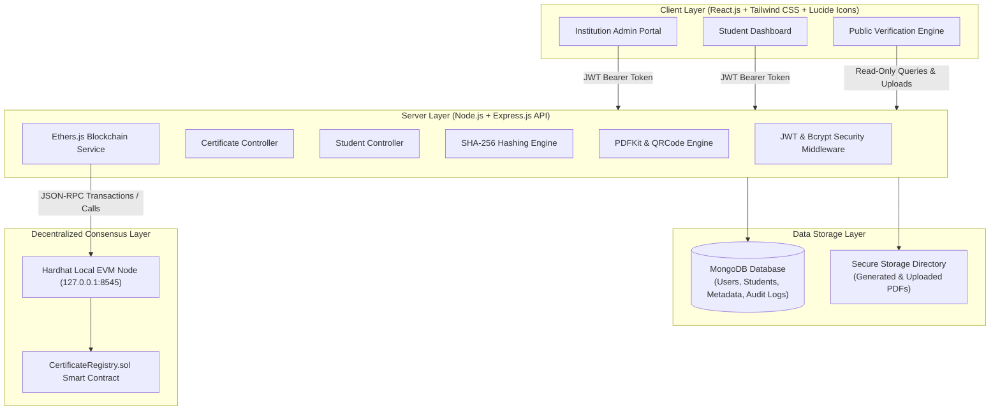
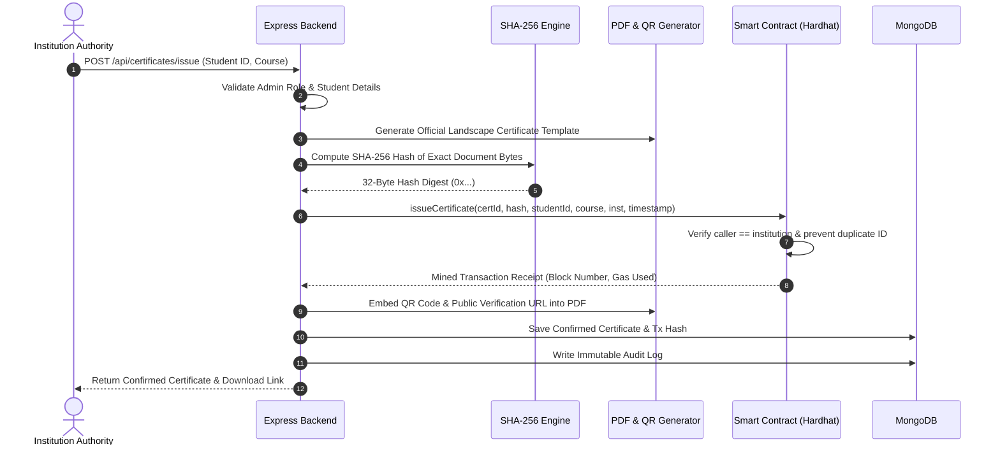
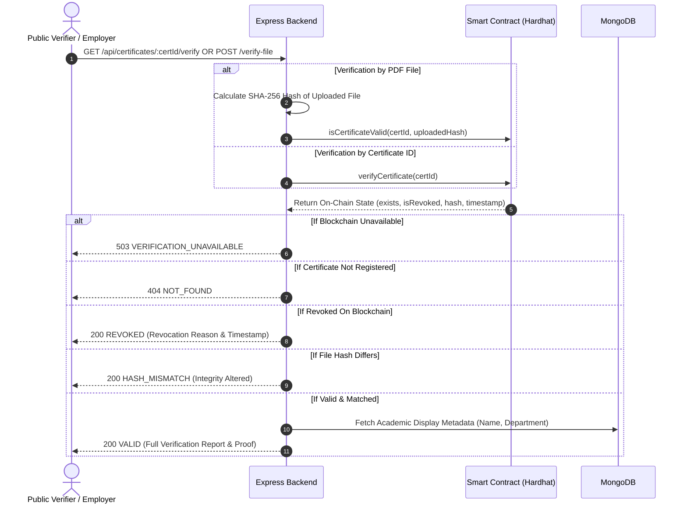

# Student Certificate Validation Using Blockchain (CertiChain)

> **Final-Year B.Tech Computer Science and Engineering Capstone Project**  
> An End-to-End Decentralized Academic Credential Verification Platform anchored on Ethereum/Hardhat Smart Contracts with SHA-256 Cryptographic Fingerprinting, Dynamic QR Codes, and Multi-Role Access Control.

---

## 1. Project Abstract

Academic credential forgery, diploma mill proliferation, and unauthorized grade alterations pose severe challenges to universities, licensing bodies, and global employers. Traditional verification relies on slow, paper-based transcripts or centralized databases susceptible to unauthorized tampering, internal corruption, and single-point-of-failure outages.

**CertiChain** resolves this challenge by establishing an authoritative, decentralized verification infrastructure. When an institution issues an academic certificate, a cryptographic SHA-256 digest is calculated from the exact original document binary bytes. This immutable fingerprint, along with non-sensitive academic metadata, is permanently anchored into an Ethereum smart contract (`CertificateRegistry.sol`) running on a local Hardhat blockchain network. The system automatically produces a downloadable PDF credential featuring an embedded, scannable QR code linking to a public verification engine. Employers, universities, and public verifiers can instantaneously validate credentials without requiring accounts, paying fees, or relying on centralized intermediaries.

---

## 2. Problem Statement & Motivation

1. **Document Tampering & Forgery:** Digital PDFs and paper diplomas can easily be modified using photo-editing tools or synthetic document generators.
2. **Slow, Bureaucratic Verification:** Manual verification by university registrars often takes between 2 to 6 weeks, causing candidate disqualifications or delayed employment.
3. **Vulnerabilities of Centralized Databases:** Centralized servers and databases can be manipulated by malicious insiders, compromised credentials, or ransomware.
4. **Irreversible Credential Status:** Once a paper certificate is distributed, revoking it due to academic malpractice or disciplinary measures is virtually impossible.

---

## 3. Existing System vs. Proposed Blockchain System

| Dimension | Conventional Verification System | Proposed Blockchain System (CertiChain) |
| :--- | :--- | :--- |
| **Trust Model** | Trust in centralized database / human registrar | Zero Trust: Verified via Ethereum smart contract |
| **Immutability** | Low: Editable rows, mutable files | 100% Cryptographic Immutability via SHA-256 & EVM |
| **Verification Speed** | 1 to 4 weeks | **Instant (< 1 second)** via public web portal / QR scan |
| **Tamper Detection** | Difficult or requires physical lab analysis | **Automatic bit-for-bit SHA-256 checksum comparison** |
| **Revocation** | Ineffective; paper diplomas cannot be recalled | Permanent, irreversible on-chain revocation event |
| **Verification Cost** | Manual postal/email fees or paid verification services | **Free, open public access** |
| **Data Privacy** | Personal details frequently emailed over insecure channels | Zero personal PII on-chain; only hashes and credentials |

---

## 4. System Architecture



---

## 5. Sequence Workflows

### 5.1 Certificate Issuance Workflow



### 5.2 Public Verification Workflow (ID & File Hash)



---

## 6. On-Chain Authoritative Fingerprint vs. Database Record

A core design principle of this project is the **separation of authoritative truth from mutable metadata**:

- **Authoritative On-Chain Fingerprint (Blockchain):**
  The smart contract stores only the cryptographic SHA-256 hash, certificate ID, student identifier, course, institution name, and revocation status. This state is immutable and tamper-proof. If MongoDB were wiped, the on-chain fingerprint remains 100% verifiable and authoritative.
- **Database Record (MongoDB):**
  MongoDB stores supplementary presentation details (student name, department, formatting metadata) and file storage paths.
- **Reconciliation Engine (`scripts/reconcile.js`):**
  If a network blip or database outage occurs right after a blockchain transaction succeeds, the reconciliation script scans on-chain `CertificateIssued` events and reconstructs any missing database records automatically.

---

## 7. Technology Stack

- **Frontend:**
  - React.js 18 with Vite
  - Tailwind CSS for responsive styling
  - Lucide React for consistent icons
  - React Router v6 for client-side navigation
  - Axios for authenticated and multipart HTTP requests
- **Backend:**
  - Node.js & Express.js
  - JSON Web Tokens (JWT) & Bcrypt password hashing
  - Multer for secure PDF uploads (strict MIME and byte validation)
  - PDFKit for generating landscape academic certificates
  - QRCode for generating scannable verification barcodes
  - Helmet & Express Rate Limiting for API protection
- **Blockchain:**
  - Solidity `^0.8.24`
  - Hardhat Local EVM Network
  - Ethers.js v6 for contract interaction and event querying
  - Ethers `NonceManager` for sequential transaction processing
- **Database:**
  - MongoDB with Mongoose ODM
  - Schema validation, compound indexing, and automated timestamps
- **Automated Testing:**
  - Hardhat Test Suite for smart contracts (Chai assertions)
  - Vitest + Supertest for backend integration API tests
  - Vitest + React Testing Library for frontend component tests

---

## 8. Smart Contract Design (`CertificateRegistry.sol`)

The smart contract is located at `blockchain/contracts/CertificateRegistry.sol`:

### State Variables
- `address public institution`: The deploying institution administrative wallet.
- `mapping(string => Certificate) private certificates`: Mapping from Certificate ID to Certificate struct.
- `uint256 public totalCertificates`: Running count of all anchored credentials.

### Data Structures
```solidity
struct Certificate {
    string certificateId;
    bytes32 certificateHash; // SHA-256 hash of original PDF file
    string studentIdentifier; // Unique roll number (e.g. STU-2024-001)
    string course;
    string institution;
    uint256 issueTimestamp;
    bool isRevoked;
    string revokeReason;
    uint256 revokeTimestamp;
    bool exists;
}
```

### Core Functions
1. `issueCertificate(...)`: Registers a unique certificate ID, SHA-256 hash, and academic metadata. Only callable by `institution`. Rejects duplicate IDs and zero hashes.
2. `revokeCertificate(string id, string reason)`: Permanently revokes a certificate. Requires a non-empty revocation reason. Emits `CertificateRevoked`.
3. `isCertificateValid(string id, bytes32 hash)`: View function returning `(bool isValid, string status)`:
   - Returns `VALID` if certificate exists, is not revoked, and hash matches.
   - Returns `HASH_MISMATCH` if uploaded file hash differs from blockchain record.
   - Returns `REVOKED` if certificate was revoked.
   - Returns `NOT_FOUND` if certificate does not exist.
4. `verifyCertificate(string id)`: Unpacks public certificate metadata and timestamps for verifiers.
5. `getCertificate(string id)`: Returns the complete on-chain `Certificate` struct.

---

## 9. Installation and Setup Guide

### Prerequisites
- **Node.js:** v18.0.0 or higher (v24+ tested)
- **npm:** v9.0.0 or higher
- **MongoDB:** Local MongoDB service running on `mongodb://127.0.0.1:27017`

### Step 1: Clone and Install Dependencies
From the project root:
```bash
# Install root orchestration packages
npm install

# Install all sub-project dependencies
npm run install:all
```

Or install individually:
```bash
cd blockchain && npm install
cd ../server && npm install
cd ../client && npm install
cd ..
```

### Step 2: Configure Environment Variables
Copy `.env.example` to `.env`:
```bash
cp .env.example .env
```
Default local values:
```env
PORT=5000
NODE_ENV=development
CLIENT_URL=http://localhost:5173
MONGODB_URI=mongodb://127.0.0.1:27017/student_certificate_blockchain
JWT_SECRET=btech_cse_blockchain_certificate_secret_key_2026
BLOCKCHAIN_RPC_URL=http://127.0.0.1:8545
INSTITUTION_PRIVATE_KEY=0xac0974bec39a17e36ba4a6b4d238ff944bacb478cbed5efcae784d7bf4f2ff80
CONTRACT_ADDRESS=
```

### Step 3: Start Hardhat Local Blockchain
Open **Terminal 1**:
```bash
npm run chain
```
This starts the local Ethereum EVM node listening at `http://127.0.0.1:8545`. Keep this running.

### Step 4: Deploy Smart Contract
Open **Terminal 2**:
```bash
npm run deploy
```
This compiles `CertificateRegistry.sol`, deploys it to the local node, outputs the contract address (e.g. `0xDc64a140Aa3E981100a9becA4E685f962f0cF6C9`), and automatically updates `.env` and `server/src/config/contractConfig.json`.

### Step 5: Seed Demo Database & Blockchain Records
In **Terminal 2**:
```bash
npm run seed
```
This initializes the administrator account, creates 5 registered students, issues sample certificate `CERT-2024-DEMO01` on-chain (VALID), and issues and revokes `CERT-2024-DEMO02` on-chain (REVOKED).

### Step 6: Start Backend Server
In **Terminal 2**:
```bash
npm run server
```
The API starts at `http://localhost:5000`. Health check: `http://localhost:5000/api/health`.

### Step 7: Start Frontend Application
Open **Terminal 3**:
```bash
npm run client
```
The web application opens at `http://localhost:5173`.

---

## 10. Demo Credentials

| Role | Email | Password | Access / Scope |
| :--- | :--- | :--- | :--- |
| **Administrator / Dean** | `admin@institution.edu` | `Admin@123` | Full administrative authority: issue, revoke, manage students, view audit logs |
| **Student 1** | `adarsh.challa@student.edu` | `Student@123` | B.Tech CSE (Adarsh Challa - Has issued demo certificate `CERT-2024-DEMO01`) |
| **Student 2** | `priya.patel@student.edu` | `Student@123` | B.Tech AI & ML (Has revoked demo certificate `CERT-2024-DEMO02`) |
| **Student 3** | `aarav.gupta@student.edu` | `Student@123` | B.Tech IT |
| **Student 4** | `sneha.reddy@student.edu` | `Student@123` | B.Tech ECE |
| **Student 5** | `vikram.singh@student.edu` | `Student@123` | B.Tech Mechanical |
| **Public Verifier** | *No login needed* | *No login needed* | Free open public verification via `/verify` |

*Tip: The login page includes convenient **One-Click Demo Login** buttons for instant testing.*

### Demo Certificate IDs for Testing

The following demo certificate IDs are pre-configured for easy testing of different verification states:

| Certificate ID | Status | Institution | Course | Student |
| :--- | :--- | :--- | :--- | :--- |
| **JE80YGRUIOD7** | ✅ VALID | Johns Hopkins University | HTML, CSS, and Javascript for Web Developers | BOLLAM PAVAN ADHITYA |
| **DEMO-VALID-002** | ✅ VALID | MIT | Machine Learning Fundamentals | John Doe |
| **DEMO-REVOKED-001** | ❌ REVOKED | Stanford University | Advanced Blockchain Development | Jane Smith |

**How to use:**
1. Navigate to the **Verify** page
2. Enter any of the Certificate IDs above
3. Click "Verify Certificate ID" to see the status
4. Click "Download Official PDF" to download the certificate
5. Use the downloaded PDF to test file-based verification

**Note:** Any other certificate ID will return **NOT_FOUND** status.

---

## 11. Step-by-Step Demonstration Script (For Project Viva / Review)

1. **Open Landing Page:**
   Navigate to `http://localhost:5173`. Explain the 3-step trust architecture and zero-trust verification pipeline.
2. **Demonstrate Public Verification (Valid Certificate):**
   Enter Certificate ID `CERT-2024-DEMO01` in the verification field.
   Observe the green **GENUINE & VALID** badge, on-chain mining transaction receipt, block number, and SHA-256 hash. Click "Download Official PDF" to view the landscape certificate with embedded QR code.
3. **Demonstrate Public Verification (Revoked Certificate):**
   Enter Certificate ID `CERT-2024-DEMO02`.
   Observe the red **OFFICIALLY REVOKED** banner, displaying the mandatory revocation justification and timestamp recorded on-chain.
4. **Demonstrate File Integrity & Tamper Detection:**
   On the Verify page, switch to the "Verify by PDF Upload" tab.
   Upload the authentic PDF certificate downloaded earlier &rarr; Status returns **GENUINE & VALID (Hash Matches)**.
   Open the PDF in a text editor, alter a single byte or character, and upload again &rarr; Status returns **HASH MISMATCH / TAMPERED**, showing both the calculated uploaded hash and on-chain hash.
5. **Demonstrate Institution Administrator Workflow:**
   Click "Portal Login" &rarr; One-Click "Admin / Dean" button &rarr; Sign In.
   Navigate to **Students** &rarr; Click "Add New Student" &rarr; Create student "Ananya Sen".
   Navigate to **Issue Certificate** &rarr; Select "Ananya Sen" &rarr; Choose "Auto-Generate" &rarr; Click "Issue & Anchor Certificate on Blockchain".
   Observe the real-time mining progress: Hashing &rarr; Smart Contract Call &rarr; Block Mining &rarr; QR Generation &rarr; Completed.
6. **Demonstrate On-Chain Revocation:**
   Navigate to **Certificates Registry** &rarr; Locate the newly issued certificate &rarr; Click the Revoke icon.
   Enter mandatory revocation reason: *"Academic credit discrepancy resolved by committee"* &rarr; Confirm.
   Immediately test the verification URL: it now displays **OFFICIALLY REVOKED**.
7. **Demonstrate Student Portal:**
   Sign out &rarr; Click "Portal Login" &rarr; One-Click "Demo Student" &rarr; Sign In.
   Observe personal dashboard: student sees only their own credentials. Click "Share / QR" to view the scannable QR code modal.
   Attempt to access `/admin/students` &rarr; System enforces role boundary and redirects safely.
8. **Demonstrate Database-to-Blockchain Reconciliation:**
   In terminal, run `npm run reconcile` to demonstrate how the system scans blockchain events and restores missing database entries if database failure occurs.

---

## 12. Running Automated Tests

Execute all test suites across all 3 layers:

```bash
# Run all tests (Blockchain + Backend)
npm test

# Run smart contract unit tests (15 test cases)
npm run test:contract

# Run backend API integration tests (16 test cases)
npm run test:server

# Run frontend UI tests (8 test cases)
npm run test:client
```

**Total automated tests:** 39 tests covering:
- Authorized issuance & revocation
- Unauthorized access rejection
- Duplicate certificate rejection
- Cryptographic hash verification and tamper mismatch
- Permanent invalidation after revocation
- Role-based authorization & ownership isolation
- Public verification outcomes
- React component status rendering and validation

---

## 13. REST API Documentation

### Authentication
- `POST /api/auth/login`: Authenticate admin or student (rate-limited).
- `POST /api/auth/logout`: Invalidate session.
- `GET /api/auth/me`: Get current authenticated user profile.

### Students (Admin Only)
- `GET /api/students`: List students with pagination, search, and department/status filtering.
- `POST /api/students`: Enroll new student and create portal login credentials.
- `GET /api/students/:id`: Get student profile.
- `PUT /api/students/:id`: Update student academic information.
- `PATCH /api/students/:id/status`: Toggle account status (active/inactive).

### Certificates
- `POST /api/certificates/issue`: Issue certificate, compute SHA-256, anchor on blockchain (Admin only).
- `GET /api/certificates`: List certificates (Admin sees all; student sees only owned).
- `GET /api/certificates/:certificateId`: Detailed certificate view with on-chain live query.
- `POST /api/certificates/:certificateId/revoke`: Revoke certificate on blockchain with mandatory reason (Admin only).
- `GET /api/certificates/:certificateId/verify`: **Public read-only** on-chain verification endpoint.
- `POST /api/certificates/:certificateId/verify-file`: **Public read-only** binary file hash verification endpoint.
- `GET /api/certificates/:certificateId/download`: Download official PDF credential with QR code.
- `GET /api/certificates/:certificateId/audit`: Retrieve immutable audit history trail.

### Dashboard
- `GET /api/dashboard/stats`: Retrieve total issued, verified, revoked, and student counts.
- `GET /api/dashboard/recent-activity`: Real-time audit activity feed.

---

## 14. Troubleshooting

1. **"Hardhat node not responding" or "VERIFICATION UNAVAILABLE":**
   Ensure Hardhat is running in Terminal 1 via `npm run chain`.
2. **"MongoDB connection error":**
   Verify the local MongoDB service is running via Windows Services (`Start-Service MongoDB`) or check `MONGODB_URI` in `.env`.
3. **"Contract address not configured":**
   Run `npm run deploy` after starting the Hardhat node to redeploy the contract and auto-sync configuration files.
4. **"Nonce too low error during high-frequency calls":**
   The project implements Ethers.js `NonceManager` to sequence transactions automatically without nonce collisions.

---

## 15. Known Limitations & Future Enhancements

- **Local EVM Chain:** Currently configured for local development using Hardhat. Can be deployed to Ethereum testnets (Sepolia / Holesky) or Polygon by updating `hardhat.config.js` RPC URLs and funding the institution wallet.
- **Decentralized Storage (IPFS):** Local storage is used for zero-cost operation. In production, IPFS / Filecoin can be added for distributed storage of the generated PDF files.
- **Multi-Institution Federation:** Can be expanded into a consortium smart contract where multiple universities are accredited via a decentralized governance registry (DAO).
- **W3C Verifiable Credentials / DIDs:** Future integration with decentralized identity standards for mobile credential wallets.

---

## 16. 25-Minute Team Video Presentation Speech

Each member should speak for approximately five minutes. The project uses
Solidity for the smart contract and JavaScript for Hardhat, backend, frontend,
deployment, and testing. Python is not required for this implementation.

### Member 1: Challa Adarsh - Project Introduction

Good morning everyone. My name is **Challa Adarsh**. Today, our team is
presenting our project called **Blockchain-Based Certificate Verification
System**, also known as **CertiChain**.

Our team members are Challa Adarsh, Bollam Pavan Adhitya, Dugyala Vinay,
Myakala Praveen, and Ganta Preetham.

The main purpose of our project is to issue, store, and verify academic
certificates securely using blockchain technology.

In the traditional certificate system, certificates are printed on paper or
stored in regular databases. This creates several problems. A person may
create a fake certificate by editing the name, course, marks, or institution
details. Verification is also difficult because employers or other
institutions need to contact the issuing college manually. This process may
require emails, phone calls, or physical visits.

Paper certificates can also be lost, damaged, or destroyed. Even if a
certificate is stored in a normal database, someone with unauthorized access
may change the information. We therefore need a system where certificate
authenticity can be checked independently and unauthorized changes can be
detected.

Our project solves this problem using blockchain. When an institution issues a
certificate, the system creates a unique certificate ID and generates a
digital fingerprint of the certificate PDF using the SHA-256 hashing
algorithm. This fingerprint is called a hash. The hash and important
certificate details are recorded in a blockchain smart contract.

If even one character or one byte in the PDF changes, the hash becomes
different. When someone uploads a certificate for verification, the system
calculates its hash again and compares it with the original hash stored on the
blockchain.

Our application has three main users. The institution administrator can
register students, issue certificates, and revoke certificates if necessary.
Students can view and download their certificates. External verifiers, such as
employers or universities, can verify a certificate using its ID or PDF file.

The workflow is simple. First, the administrator selects an active student and
enters the course and institution details. The system generates or accepts a
certificate PDF, calculates its hash, and sends the hash to the smart
contract. The blockchain stores the certificate information. The certificate
is then saved in the database and made available for download.

For verification, a user enters the certificate ID or uploads the PDF. The
backend checks the blockchain record and returns `VALID`, `HASH_MISMATCH`,
`REVOKED`, or `NOT_FOUND`.

The advantages of our project are security, transparency, faster verification,
tamper detection, and reduced certificate fraud. The blockchain stores the
certificate metadata and cryptographic hash rather than the complete PDF.

Our technology stack includes Solidity, JavaScript, Hardhat, Ethers.js,
Node.js, Express, MongoDB, and React. I will now hand over to Bollam Pavan
Adhitya, who will explain the smart contract.

### Member 2: Bollam Pavan Adhitya - Smart Contract Logic

Good morning everyone. My name is **Bollam Pavan Adhitya**. I will explain the
main blockchain logic in
`blockchain/contracts/CertificateRegistry.sol`.

This file contains our Solidity smart contract. A smart contract is a program
deployed on a blockchain that stores data and performs operations according to
predefined rules.

The contract has an `institution` variable containing the wallet address of
the authorized institution. When the contract is deployed, the deployer
becomes the institution. The `Certificate` structure stores the certificate
ID, certificate hash, student identifier, course, institution, issue
timestamp, revocation status, revocation reason, revocation timestamp, and an
`exists` flag.

Certificate records are stored in a mapping. The certificate ID is the key,
which allows the contract to find a certificate efficiently.

The `onlyInstitution` modifier checks whether the caller is the authorized
institution. If an unauthorized wallet tries to issue or revoke a certificate,
the transaction fails with the `OnlyInstitution` error.

The `issueCertificate()` function receives the certificate ID, file hash,
student ID, course, institution, and timestamp. It rejects an empty ID, an
empty hash, and a duplicate certificate ID. If the data is valid, it stores the
certificate, increases `totalCertificates`, and emits the `CertificateIssued`
event.

The `revokeCertificate()` function allows the institution to revoke a
certificate. It checks that the certificate exists, has not already been
revoked, and has a non-empty reason. It then stores the reason and blockchain
timestamp, marks the certificate as revoked, and emits `CertificateRevoked`.

The `isCertificateValid()` function performs the main verification. It returns
`NOT_FOUND` when the ID is unknown, `REVOKED` when the certificate was
revoked, and `HASH_MISMATCH` when the submitted hash differs from the stored
hash. If all checks succeed, it returns `VALID`.

The `getCertificate()` function returns the complete certificate structure.
The `verifyCertificate()` function returns certificate details separately,
including the hash, student identifier, course, institution, and revocation
information.

The contract uses custom errors such as `EmptyHash`,
`CertificateAlreadyExists`, and `CertificateAlreadyRevoked`. It also uses
events so the backend and other applications can detect blockchain activity.

This contract protects the certificate registry because only the institution
can issue or revoke records, duplicate IDs are rejected, and changes to a PDF
can be detected through hash comparison. I will now hand over to Dugyala
Vinay, who will explain the contract tests.

### Member 3: Dugyala Vinay - Smart Contract Testing

Good morning everyone. My name is **Dugyala Vinay**. I will explain the
automated tests in
`blockchain/test/CertificateRegistry.test.js`.

Testing is important because blockchain transactions are permanent. Our test
file uses JavaScript, Hardhat, Ethers, and Chai. The `describe()` blocks
organize tests into deployment, issuance, verification, and revocation.

The `beforeEach()` function runs before every test. It creates blockchain
accounts, uses one account as the institution, uses another account for
unauthorized-access tests, deploys a fresh contract, and creates sample and
mismatched hashes. A fresh contract ensures that every test starts with a
clean state.

The deployment tests confirm that the deployer becomes the institution and
that the initial certificate count is zero.

The issuance tests issue a valid certificate and expect the
`CertificateIssued` event. They then check that the total count is one and
that `getCertificate()` returns the correct certificate ID, hash, student
identifier, revocation status, and existence value.

The security tests connect with the unauthorized account and attempt to issue
a certificate. The transaction must fail with `OnlyInstitution`. Another test
issues a certificate and tries to issue the same ID again; it must fail with
`CertificateAlreadyExists`. Empty IDs and empty hashes are also tested and
must produce the corresponding custom errors.

The verification tests first issue a certificate. A correct hash must return
`true` and `VALID`. A different hash represents a modified PDF and must return
`false` and `HASH_MISMATCH`. An unknown ID must return `false` and
`NOT_FOUND`. The `verifyCertificate()` test checks that all certificate
metadata is returned correctly.

The revocation tests confirm that the institution can revoke a certificate
with a reason. They verify the revocation event, the `isRevoked` flag, the
stored reason, and the fact that future validation returns `REVOKED`.

Additional tests confirm that unauthorized users cannot revoke certificates,
an empty reason is rejected, and an already revoked certificate cannot be
revoked again. The final test confirms that a revoked certificate cannot be
issued again with the same ID.

These tests cover normal operations, invalid input, unauthorized access,
duplicate IDs, tampered files, and permanent revocation. We can run them with
`npm run test:contract` from the project root or `npx hardhat test` inside the
blockchain folder. I will now hand over to Myakala Praveen, who will explain
the backend and blockchain connection.

### Member 4: Myakala Praveen - Backend and Blockchain Integration

Good morning everyone. My name is **Myakala Praveen**. I will explain how the
backend connects the web application, database, PDF files, and blockchain.

The main files are
`server/src/controllers/certificateController.js`,
`server/src/services/blockchainService.js`, and
`server/src/services/hashService.js`.

The `issueCertificate` controller first reads the student ID, course, and
institution. It checks that the student exists and has an active account. It
then generates a unique certificate ID and a public verification URL.

The system supports an uploaded PDF or an automatically generated PDF. After
obtaining the original PDF bytes, the controller calls
`calculateBufferHash()` in `hashService.js`. This function calculates a
lowercase SHA-256 hexadecimal hash. The service also provides
`calculateFileHash()` for hashing a file stream.

The `toContractBytes32()` function converts the 64-character SHA-256 value
into the `0x`-prefixed `bytes32` format required by Solidity.

The controller then calls `issueCertificateOnChain()` in
`blockchainService.js`. This service uses Ethers.js to connect to the local
Hardhat network at `127.0.0.1:8545`. It loads the contract address and ABI,
creates a provider for blockchain access, and creates a signer representing
the institution wallet.

Before sending the transaction, the service checks whether the blockchain is
available. It calls the smart contract with the certificate ID, converted
hash, student identifier, course, institution, and timestamp. It waits for
one confirmation and returns the transaction hash, block number, contract
address, issuing wallet, and gas used.

After blockchain confirmation, the controller generates the final PDF and
saves certificate metadata in MongoDB. The database record includes the
certificate ID, student information, file hash, file paths, transaction hash,
contract address, block number, and verification URL. An audit log records
who issued the certificate and the blockchain transaction details.

The controller also handles failures. If the blockchain is unavailable, it
returns a service-unavailable response. If the blockchain transaction
succeeds but the database write fails, it creates a reconciliation record so
the on-chain certificate is not lost.

The backend is therefore the bridge between the React frontend, MongoDB, PDF
storage, hashing service, and Solidity smart contract. I will now hand over to
Ganta Preetham, who will explain the frontend.

### Member 5: Ganta Preetham - Frontend and Verification

Good morning everyone. My name is **Ganta Preetham**. I will explain the
frontend pages
`client/src/pages/admin/IssueCertificate.jsx`,
`client/src/pages/VerifyPage.jsx`, and
`client/src/services/api.js`.

The frontend is built with React. React state variables store form values,
selected files, loading status, errors, and verification results.

The `IssueCertificate.jsx` page is used by an administrator. When it opens,
the `useEffect()` hook requests active students from the backend. The
administrator selects a student, and the course field is filled from the
student record. The administrator can select automatic PDF generation or
upload an existing PDF.

When the form is submitted, `handleSubmit()` validates the student and file.
It creates a `FormData` object containing the student ID, course, institution,
and optional PDF. It sends this data to the backend. The page displays the
stages hashing, contract call, mining, and completion. After success, it
displays the certificate ID, transaction hash, block number, and SHA-256 hash.
It also provides download and verification links.

The `VerifyPage.jsx` page supports verification by certificate ID and by PDF
upload. For ID verification, the user enters an ID and is taken to the
verification result page. For file verification, the page checks that the
selected file is a PDF, accepts the certificate ID, and sends the file to the
backend endpoint
`/certificates/{certificateId}/verify-file`.

The backend calculates the uploaded file hash and compares it with the
on-chain hash. The result can be `VALID`, `REVOKED`, `HASH_MISMATCH`, or
`NOT_FOUND`. The page displays loading indicators and clear error messages.
It can also detect a certificate ID from a filename containing a pattern such
as `CERT-2026-XXXXXX`.

The `api.js` service centralizes frontend requests to the backend. This avoids
duplicating request logic across components and makes the application easier
to maintain.

The frontend does not directly expose the institution private key or write to
the blockchain. It sends requests to the backend, which performs hashing and
blockchain operations securely. The complete flow is therefore: the React
interface collects data, the backend hashes the PDF, the smart contract stores
the hash, and the verification page checks the certificate later.

This completes our presentation of the Blockchain-Based Certificate
Verification System. Thank you.

## 17. License

This project is submitted as a final-year B.Tech CSE Capstone Project. Open source under the MIT License.
